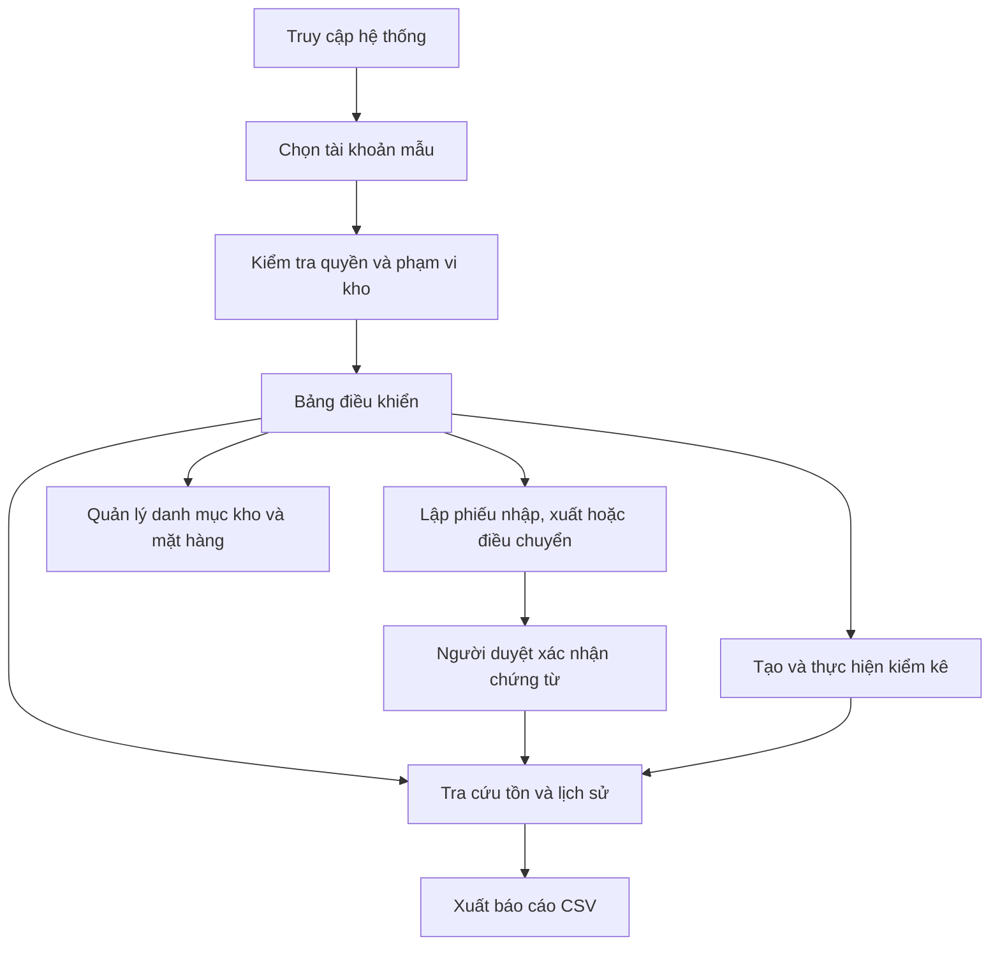
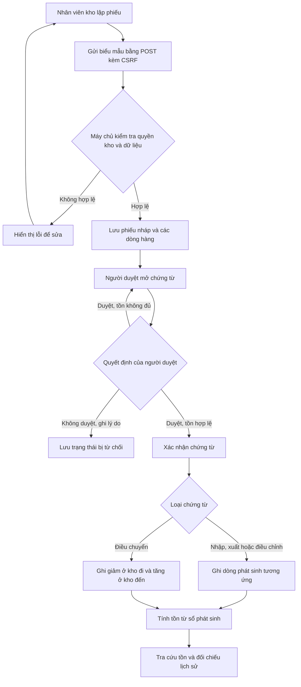
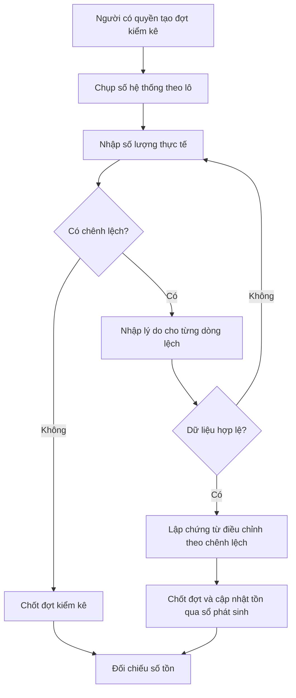

# Hệ thống quản lý kho, điều chuyển hàng và kiểm kê tại nhiều điểm

Bài tập lớn học phần **Phát triển phần mềm mã nguồn mở**, nhóm 5, lớp CNTT-1812, **đề tài 10**.

Phần mềm mã nguồn mở giúp một đơn vị có nhiều kho theo dõi số lượng hàng, ghi nhận chứng từ nhập, xuất và điều chuyển, và tìm nguyên nhân chênh lệch khi kiểm kê. Số tồn **không nhập tay**: hệ thống luôn tính lại từ sổ phát sinh của các chứng từ đã xác nhận, nên có thể đối chiếu bất cứ lúc nào.

> **Trạng thái hiện tại:** kho, mặt hàng, đơn vị tính, lô và quyền đã đọc/ghi PostgreSQL. Phiếu nhập/xuất được lưu nháp và ghi sổ khi người duyệt xác nhận trong giao dịch. Điều chuyển và kiểm kê vẫn đang ở mức giao diện/bản xem trước.

## Thành viên

| Họ tên | MSSV | Phụ trách |
| ------ | ---- | --------- |
| \_\_   |      |           |
| \_\_   |      |           |

## Người sử dụng

| Vai trò                 | Quyền                                                                            |
| ----------------------- | -------------------------------------------------------------------------------- |
| Nhân viên kho           | Lập phiếu nhập, xuất, điều chuyển tại kho mình phụ trách; tra cứu tồn và lịch sử |
| Người duyệt chứng từ    | Duyệt hoặc không duyệt chứng từ chờ xử lý; từ chối phải ghi lý do                |
| Người phụ trách kiểm kê | Tạo đợt kiểm kê, nhập số thực tế, xác nhận chênh lệch kèm lý do                  |

Mỗi tài khoản chỉ thao tác trên **các kho được phân quyền**. Quyền được kiểm tra phía máy chủ ở từng yêu cầu, không chỉ ẩn nút trên giao diện.

## Chức năng

| #   | Chức năng                                                                                      | Trang                                            | Trạng thái            |
| --- | ---------------------------------------------------------------------------------------------- | ------------------------------------------------ | --------------------- |
| 1   | Quản lý kho, mặt hàng, đơn vị tính, lô hàng và quyền theo kho                                  | `/warehouses.php`, `/items.php`, `/access.php`   | Đã ghi PostgreSQL; quản trị viên quản lý danh mục |
| 2   | Lập, kiểm tra, xác nhận hoặc từ chối phiếu nhập/xuất; tra cứu tồn từ dòng phát sinh            | `/voucher-new.php`, `/voucher.php`, `/stock.php` | Đã ghi PostgreSQL; duyệt có khóa tồn; từ chối lưu lý do và không ghi phát sinh |
| 3   | Điều chuyển giữa hai kho, có chứng từ ở cả nơi đi và nơi đến                                   | `/voucher-new.php?type=transfer`                 | Giao diện ✔ · CSDL ⏳ |
| 4   | Tạo đợt kiểm kê, nhập số thực tế, tính chênh lệch, lập chứng từ điều chỉnh có lý do            | `/counts.php`, `/count.php`                      | Giao diện ✔ · CSDL ⏳ |
| 5   | Lịch sử hàng, đối chiếu tồn, xuất báo cáo CSV; sửa bằng chứng từ điều chỉnh, không xóa lịch sử | `/history.php`, `/export.php`                    | Giao diện ✔ · CSDL ⏳ |

## Luồng hoạt động

### Luồng sử dụng tổng quát



### Luồng chứng từ và cập nhật tồn



### Luồng kiểm kê



> **Lưu ý:** Luồng phiếu nhập/xuất đã ghi PostgreSQL. Điều chuyển và chốt kiểm kê vẫn mới hiển thị bản xem trước, chưa ghi vào CSDL.

### Hai yêu cầu kỹ thuật

1. **Sổ phát sinh và giao dịch cập nhật tồn.** Khi nhiều yêu cầu cùng xuất, số tồn không được âm. Gửi lại một chứng từ không được ghi nhận thêm lần nữa.
2. **Điều chuyển trong cùng một giao dịch.** Trừ kho đi và cộng kho đến phải cùng thành công hoặc cùng thất bại; số tồn luôn khớp sổ phát sinh.

`src/StockLedger.php` tính tồn từ sổ và tạo phát sinh dự kiến. `src/VoucherService.php` lưu phiếu nháp, xác nhận nhập/xuất trong giao dịch, khóa kho/lô để ngăn xuất đồng thời làm tồn âm, từ chối phiếu cùng lý do/người/thời điểm xử lý và bảo đảm gửi lại yêu cầu không ghi trùng. Phiếu bị từ chối không tạo phát sinh tồn kho. Giao dịch điều chuyển hai kho chưa được triển khai.

## Cài đặt và chạy

Yêu cầu: Ubuntu hoặc WSL, **PHP 8.1 trở lên**, Git, PostgreSQL và PHP PDO PostgreSQL. Không cần Composer hay framework.

```bash
sudo apt install php-cli php-pgsql git postgresql postgresql-client  # nếu chưa có
git clone <địa chỉ repo>
cd PTPMMNM-CNTT-1812-NHOM-5
bash app.sh check                 # kiểm tra môi trường
bash app.sh run                   # chạy tại http://127.0.0.1:8110
```

Đổi cổng bằng `PORT=8200 bash app.sh run`. Dừng máy chủ bằng `Ctrl+C`.

### Khởi tạo PostgreSQL

Schema ban đầu nằm ở `database/schema.sql`. Trên Ubuntu/WSL, khởi động PostgreSQL rồi mở phiên quản trị:

```bash
sudo service postgresql start
sudo -u postgres psql
```

Trong `psql`, nhập từng lệnh ở dấu nhắc `postgres=#`. Khi chạy `\password`, nhập mật khẩu ở hai lời nhắc của nó; đợi quay lại `postgres=#` rồi mới nhập lệnh kế tiếp:

```sql
CREATE ROLE ptpmmnm_cntt_1812_nhom_5 LOGIN;
```

```text
\password ptpmmnm_cntt_1812_nhom_5
```

```sql
CREATE DATABASE ptpmmnm_cntt_1812_nhom_5 OWNER ptpmmnm_cntt_1812_nhom_5;
\q
```

Chạy lại lệnh `CREATE` chỉ khi các tên đó chưa tồn tại. Sau đó kết nối đúng database và nạp bảng:

```bash
psql -h 127.0.0.1 -U ptpmmnm_cntt_1812_nhom_5 -d ptpmmnm_cntt_1812_nhom_5
```

```sql
\i database/schema.sql
\dt
\q
```

Sau khi chạy các lệnh trên, database và schema sẽ sẵn sàng. Từ thư mục dự án, cấu hình kết nối ứng dụng:

```bash
php tools/db-config.php
```

Nhập cùng host, database, user và mật khẩu vừa tạo. Công cụ thử kết nối trước khi lưu `.local/db.json` với quyền riêng tư; tệp này đã được loại khỏi Git. Sau đó `bash app.sh run` sẽ đọc các bảng PostgreSQL. Bảng đang rỗng cho đến khi nạp dữ liệu mẫu. Phiếu nhập/xuất được lưu nháp và xác nhận vào sổ; điều chuyển và kiểm kê vẫn đang ở bản xem trước.

Để nạp dữ liệu mẫu (chạy từ thư mục gốc của dự án):

```bash
psql -h 127.0.0.1 -U ptpmmnm_cntt_1812_nhom_5 -d ptpmmnm_cntt_1812_nhom_5 -f database/seed.sql
```

Lệnh sẽ hỏi mật khẩu database. `database/seed.sql` nạp 3 kho, 30 mặt hàng và 203 dòng phát sinh; script chỉ chạy khi các bảng đang trống.

### Tài khoản mẫu

Trang đăng nhập dùng tên đăng nhập và mật khẩu. Năm tài khoản mẫu dùng chung mật khẩu `KhoMau@2026`:

| Tài khoản                | Vai trò              | Kho             |
| ------------------------ | -------------------- | --------------- |
| `nv.hn`, Nguyễn Văn An   | Nhân viên kho        | KHO-HN          |
| `nv.dn`, Trần Thị Bình   | Nhân viên kho        | KHO-DN          |
| `duyet`, Lê Minh Châu    | Người duyệt chứng từ | Cả 3 kho        |
| `kiemke`, Phạm Quốc Dũng | Phụ trách kiểm kê    | KHO-HN, KHO-HCM |
| `quantri`, Quản trị hệ thống | Quản trị danh mục | Cả 3 kho |

Mật khẩu được lưu dưới dạng hash trong database. Tài khoản `quantri` quản lý kho, mặt hàng, đơn vị tính, lô hàng, tài khoản và phạm vi kho; không dùng tài khoản mẫu này ngoài môi trường demo. Nếu database mẫu đã có từ phiên bản trước, chạy lại `database/schema.sql` rồi nạp `database/migrate-catalog-admin.sql` để thêm quản trị viên demo. Nếu dữ liệu mẫu đã được nạp trước khi có mật khẩu, chạy `database/demo-passwords.sql` một lần. Đây là mật khẩu dùng cho dữ liệu giả lập.

## Hai tình huống demo

1. **Nhập → xác nhận → xuất → tra cứu.** Đăng nhập `nv.hn` để lập phiếu nhập. Đổi sang `duyet` để mở phiếu chờ duyệt và xác nhận. Sau đó lập phiếu xuất, rồi vào _Tra cứu tồn_ và _Lịch sử phát sinh_ để đối chiếu.
2. **Điều chuyển → kiểm kê → điều chỉnh.** Lập phiếu điều chuyển KHO-HCM → KHO-DN và xem hai dòng phát sinh (−/+). Đăng nhập `kiemke`, mở đợt `KK-0002`, nhập số thực tế và lý do, xem chênh lệch cùng chứng từ điều chỉnh sẽ lập. Đợt `KK-0001` là mẫu đã chốt, có chứng từ `DC-0001`.

## Kiểm thử

```bash
bash app.sh test    # logic nghiệp vụ: TESTS=19 FAILED=0
bash app.sh lint    # kiểm tra cú pháp mọi tệp PHP
```

Đối chiếu với các phép thử bắt buộc của đề:

| Phép thử bắt buộc                                                 | Hiện tại                                                                    |
| ----------------------------------------------------------------- | --------------------------------------------------------------------------- |
| Kho còn 5, hai yêu cầu cùng xuất 4: chỉ một phiếu được ghi nhận   | Có khóa kho/lô và kiểm tra lại trong giao dịch; kiểm thử đồng thời thật cần bổ sung ⏳ |
| Lỗi giữa lúc trừ kho A và cộng kho B: không có thay đổi dở dang   | Đã kiểm tra tổng phát sinh điều chuyển = 0; kiểm tra rollback cần CSDL ⏳   |
| Gửi lại yêu cầu lập hoặc xác nhận phiếu đã xử lý: không ghi trùng  | Có khóa idempotency khi lập; xác nhận khóa phiếu và chỉ chuyển trạng thái từ nháp một lần |
| Tài khoản kho A không lập phiếu xuất kho B bằng yêu cầu trực tiếp | ✔ `WAREHOUSE_FORBIDDEN`, kiểm tra ở `validateVoucher` và mọi trang chi tiết |
| Điều chỉnh kiểm kê có lý do; tồn sau điều chỉnh khớp lịch sử      | ✔ bắt buộc lý do (`REASON_REQUIRED`); điều chỉnh khớp tổng chênh lệch       |

## Cấu trúc mã nguồn

Phần xử lý được tách khỏi giao diện và lưu trữ, theo cách tổ chức của các bài lab:

```
public/        Trang Web: nhận request, gọi xử lý, hiển thị (không chứa quy tắc nghiệp vụ)
  assets/css/  Giao diện (CSS thuần, có chế độ tối)
src/
  bootstrap.php   Session, CSRF, hàm hiển thị dùng chung
  StockLedger.php Quy tắc tồn kho thuần: tính tồn từ sổ, phát sinh của chứng từ, phát hiện tồn âm
  VoucherService.php Lưu phiếu nháp và xác nhận phiếu nhập/xuất trong giao dịch
  Validation.php  Kiểm tra form phía máy chủ, trả ['errors' => [...], 'data' => [...]]
  Auth.php        Người dùng hiện tại, quyền theo kho, quyền xác nhận
  Store.php       Đọc dữ liệu PostgreSQL theo cấu trúc dùng trong giao diện
  Database.php    Mở kết nối PostgreSQL từ cấu hình cục bộ
  Input.php       Đọc đầu vào an toàn và escape HTML (e())
templates/     Phần đầu/cuối trang, hộp lỗi
tests/         Bộ kiểm thử logic
tools/         Cấu hình kết nối PostgreSQL
app.sh         check | run | test | lint
```

Quy ước: mọi thao tác thay đổi dữ liệu dùng POST, có CSRF token và chuyển hướng 303. Mọi giá trị in ra HTML đều qua `e()`. Kiểm tra quyền luôn đặt ở phía máy chủ.

## Dữ liệu mẫu

Các bảng PostgreSQL hiện chưa được nạp dữ liệu. Cần thêm dữ liệu mẫu trước khi dùng chức năng đăng nhập và tra cứu. Đề bài yêu cầu tối thiểu **3 kho, 30 mặt hàng và 200 dòng phát sinh**.

Bảng dự kiến khi chuyển sang CSDL: `warehouses`, `items`, `batches`, `users`, `user_warehouses`, `vouchers`, `voucher_lines`, `stock_movements`, `stock_counts`, `stock_count_lines`.

## Lộ trình

- [x] Giao diện 5 nhóm chức năng, quyền theo kho, dữ liệu mẫu
- [x] Quy tắc sổ phát sinh và kiểm thử logic
- [x] Schema PostgreSQL và lớp đọc dữ liệu qua PDO
- [x] Quản lý danh mục kho, mặt hàng, đơn vị tính, lô hàng và phân quyền tài khoản theo kho
- [ ] Nạp dữ liệu mẫu vào PostgreSQL
- [x] Lập và xác nhận phiếu nhập/xuất trong giao dịch, khóa tồn theo kho/lô, khóa idempotency
- [ ] Điều chuyển trong một giao dịch; kiểm thử rollback khi gây lỗi giữa hai thao tác
- [ ] Kiểm thử tích hợp cho 5 phép thử bắt buộc, kể cả hai yêu cầu xuất đồng thời
- [x] Đăng nhập bằng mật khẩu (`password_hash`)
- [ ] GitHub Actions và bản phát hành

Không thuộc phạm vi: sản xuất, thuế, kế toán tài chính, website bán hàng, thanh toán.

## Đóng góp và giấy phép

- Quy trình issue, nhánh và review: xem [CONTRIBUTING.md](CONTRIBUTING.md).
- Mã nguồn phát hành theo giấy phép [MIT](LICENSE).
- **Nguồn tái sử dụng:** cách tổ chức `field()`, `e()`, `checkCsrf()` và mẫu `tests/helper.php` dựa trên mã mẫu CommunityPass của các bài lab học phần. Phần còn lại do nhóm tự viết. Không dùng thư viện bên ngoài.
