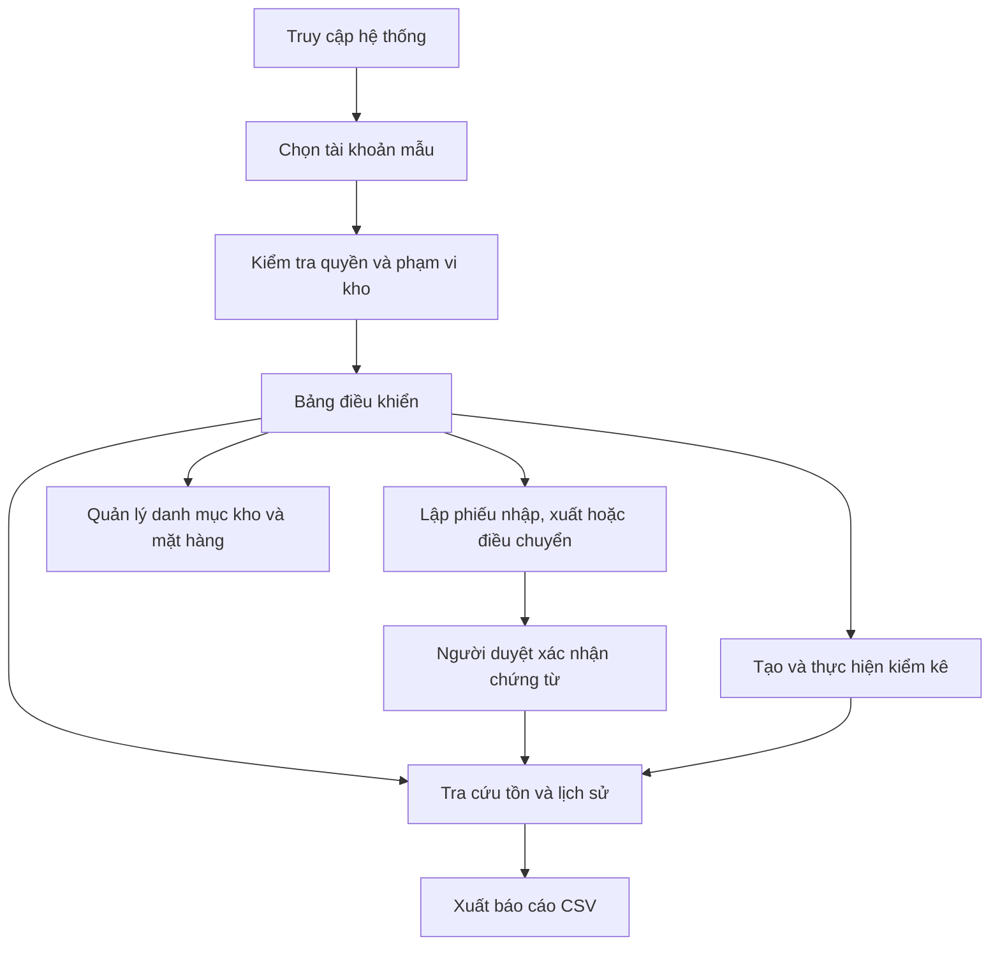
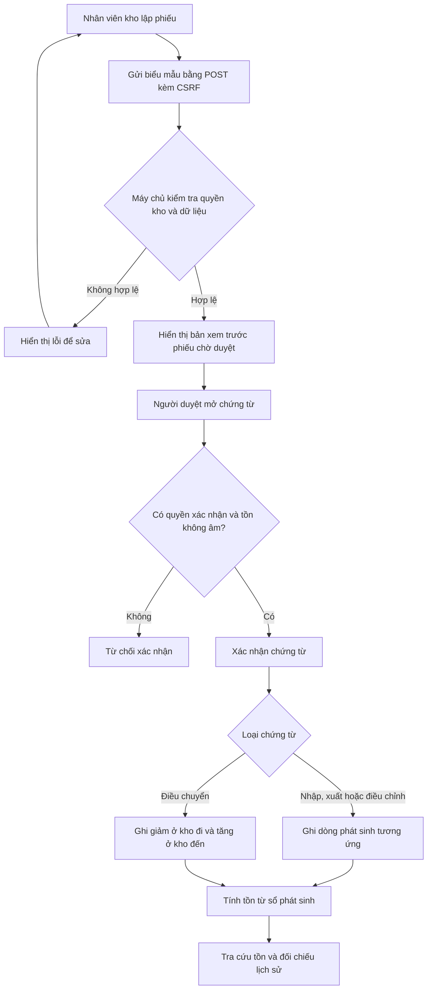
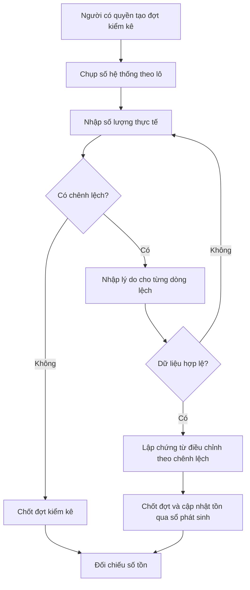

# Hệ thống quản lý kho, điều chuyển hàng và kiểm kê tại nhiều điểm

Bài tập lớn học phần **Phát triển phần mềm mã nguồn mở**, nhóm 5, lớp CNTT-1812, **đề tài 10**.

Phần mềm mã nguồn mở giúp một đơn vị có nhiều kho theo dõi số lượng hàng, ghi nhận chứng từ nhập, xuất và điều chuyển, và tìm nguyên nhân chênh lệch khi kiểm kê. Số tồn **không nhập tay**: hệ thống luôn tính lại từ sổ phát sinh của các chứng từ đã xác nhận, nên có thể đối chiếu bất cứ lúc nào.

> **Trạng thái hiện tại:** đã có giao diện và logic nghiệp vụ, chạy trên dữ liệu giả trong `data/seed.php`. Các thao tác ghi (lập phiếu, xác nhận, kiểm kê) đã kiểm tra dữ liệu và quyền ở phía máy chủ, nhưng **chưa lưu CSDL**. Giai đoạn tiếp theo sẽ chuyển sang PostgreSQL/MySQL và dùng giao dịch (xem [Lộ trình](#lộ-trình)).

## Thành viên

| Họ tên | MSSV | Phụ trách |
| ------ | ---- | --------- |
| \_\_   |      |           |
| \_\_   |      |           |

## Người sử dụng

| Vai trò                 | Quyền                                                                            |
| ----------------------- | -------------------------------------------------------------------------------- |
| Nhân viên kho           | Lập phiếu nhập, xuất, điều chuyển tại kho mình phụ trách; tra cứu tồn và lịch sử |
| Người duyệt chứng từ    | Xác nhận chứng từ chờ duyệt; khi xác nhận, sổ phát sinh mới được ghi             |
| Người phụ trách kiểm kê | Tạo đợt kiểm kê, nhập số thực tế, xác nhận chênh lệch kèm lý do                  |

Mỗi tài khoản chỉ thao tác trên **các kho được phân quyền**. Quyền được kiểm tra phía máy chủ ở từng yêu cầu, không chỉ ẩn nút trên giao diện.

## Chức năng

| #   | Chức năng                                                                                      | Trang                                            | Trạng thái            |
| --- | ---------------------------------------------------------------------------------------------- | ------------------------------------------------ | --------------------- |
| 1   | Quản lý kho, mặt hàng, đơn vị tính, lô hàng và quyền theo kho                                  | `/warehouses.php`, `/items.php`                  | Giao diện ✔ · CSDL ⏳ |
| 2   | Lập, kiểm tra, xác nhận phiếu nhập/xuất; tra cứu tồn từ dòng phát sinh                         | `/voucher-new.php`, `/voucher.php`, `/stock.php` | Giao diện ✔ · CSDL ⏳ |
| 3   | Điều chuyển giữa hai kho, có chứng từ ở cả nơi đi và nơi đến                                   | `/voucher-new.php?type=transfer`                 | Giao diện ✔ · CSDL ⏳ |
| 4   | Tạo đợt kiểm kê, nhập số thực tế, tính chênh lệch, lập chứng từ điều chỉnh có lý do            | `/counts.php`, `/count.php`                      | Giao diện ✔ · CSDL ⏳ |
| 5   | Lịch sử hàng, đối chiếu tồn, xuất báo cáo CSV; sửa bằng chứng từ điều chỉnh, không xóa lịch sử | `/history.php`, `/export.php`                    | Giao diện ✔ · CSDL ⏳ |

## Luồng hoạt động

### Luồng sử dụng tổng quát



### Luồng chứng từ và cập nhật tồn



### Luồng kiểm kê



> **Lưu ý:** Các biểu đồ mô tả luồng nghiệp vụ của ứng dụng. Ở phiên bản hiện tại, lập phiếu, xác nhận và chốt kiểm kê mới kiểm tra dữ liệu rồi hiển thị bản xem trước; chưa ghi vào CSDL. Khi tích hợp CSDL, phát sinh sẽ được ghi sổ khi chứng từ được xác nhận.

### Hai yêu cầu kỹ thuật

1. **Sổ phát sinh và giao dịch cập nhật tồn.** Khi nhiều yêu cầu cùng xuất, số tồn không được âm. Gửi lại một chứng từ không được ghi nhận thêm lần nữa.
2. **Điều chuyển trong cùng một giao dịch.** Trừ kho đi và cộng kho đến phải cùng thành công hoặc cùng thất bại; số tồn luôn khớp sổ phát sinh.

Hiện tại `src/StockLedger.php` đã có phần quy tắc: tính tồn từ sổ, sinh hai dòng phát sinh cho điều chuyển, phát hiện tồn âm. Phần khóa dòng và giao dịch CSDL sẽ làm ở giai đoạn sau.

## Cài đặt và chạy

Yêu cầu: Ubuntu hoặc WSL, **PHP 8.1 trở lên**, Git. Giai đoạn này chưa cần CSDL, Composer hay framework.

```bash
sudo apt install php-cli git      # nếu chưa có
git clone <địa chỉ repo>
cd PTPMMNM-CNTT-1812-NHOM-5
bash app.sh check                 # kiểm tra môi trường
bash app.sh run                   # chạy tại http://127.0.0.1:8110
```

Đổi cổng bằng `PORT=8200 bash app.sh run`. Dừng máy chủ bằng `Ctrl+C`.

### Tài khoản mẫu

Trang đăng nhập cho chọn một trong bốn tài khoản giả (giai đoạn giao diện chưa dùng mật khẩu):

| Tài khoản                | Vai trò              | Kho             |
| ------------------------ | -------------------- | --------------- |
| `nv.hn`, Nguyễn Văn An   | Nhân viên kho        | KHO-HN          |
| `nv.dn`, Trần Thị Bình   | Nhân viên kho        | KHO-DN          |
| `duyet`, Lê Minh Châu    | Người duyệt chứng từ | Cả 3 kho        |
| `kiemke`, Phạm Quốc Dũng | Phụ trách kiểm kê    | KHO-HN, KHO-HCM |

## Hai tình huống demo

1. **Nhập → xác nhận → xuất → tra cứu.** Đăng nhập `nv.hn` để lập phiếu nhập. Đổi sang `duyet` để mở phiếu chờ duyệt và xác nhận. Sau đó lập phiếu xuất, rồi vào _Tra cứu tồn_ và _Lịch sử phát sinh_ để đối chiếu.
2. **Điều chuyển → kiểm kê → điều chỉnh.** Lập phiếu điều chuyển KHO-HCM → KHO-DN và xem hai dòng phát sinh (−/+). Đăng nhập `kiemke`, mở đợt `KK-0002`, nhập số thực tế và lý do, xem chênh lệch cùng chứng từ điều chỉnh sẽ lập. Đợt `KK-0001` là mẫu đã chốt, có chứng từ `DC-0001`.

## Kiểm thử

```bash
bash app.sh test    # logic nghiệp vụ: TESTS=19 FAILED=0
bash app.sh lint    # kiểm tra cú pháp mọi tệp PHP
```

Đối chiếu với các phép thử bắt buộc của đề:

| Phép thử bắt buộc                                                 | Hiện tại                                                                    |
| ----------------------------------------------------------------- | --------------------------------------------------------------------------- |
| Kho còn 5, hai yêu cầu cùng xuất 4: chỉ một phiếu được ghi nhận   | Đã kiểm tra tuần tự (`tests/run.php`); bản đồng thời thật cần CSDL ⏳       |
| Lỗi giữa lúc trừ kho A và cộng kho B: không có thay đổi dở dang   | Đã kiểm tra tổng phát sinh điều chuyển = 0; kiểm tra rollback cần CSDL ⏳   |
| Gửi lại chứng từ đã xác nhận: tồn và sổ không tăng                | Cần khóa idempotency trong CSDL ⏳                                          |
| Tài khoản kho A không lập phiếu xuất kho B bằng yêu cầu trực tiếp | ✔ `WAREHOUSE_FORBIDDEN`, kiểm tra ở `validateVoucher` và mọi trang chi tiết |
| Điều chỉnh kiểm kê có lý do; tồn sau điều chỉnh khớp lịch sử      | ✔ bắt buộc lý do (`REASON_REQUIRED`); điều chỉnh khớp tổng chênh lệch       |

## Cấu trúc mã nguồn

Phần xử lý được tách khỏi giao diện và lưu trữ, theo cách tổ chức của các bài lab:

```
public/        Trang Web: nhận request, gọi xử lý, hiển thị (không chứa quy tắc nghiệp vụ)
  assets/css/  Giao diện (CSS thuần, có chế độ tối)
src/
  bootstrap.php   Session, CSRF, hàm hiển thị dùng chung
  StockLedger.php Quy tắc tồn kho thuần: tính tồn từ sổ, phát sinh của chứng từ, phát hiện tồn âm
  Validation.php  Kiểm tra form phía máy chủ, trả ['errors' => [...], 'data' => [...]]
  Auth.php        Người dùng hiện tại, quyền theo kho, quyền xác nhận
  Store.php       Truy cập dữ liệu (hiện đọc seed; sẽ thay bằng PDO, giữ nguyên tên hàm)
  Input.php       Đọc đầu vào an toàn và escape HTML (e())
templates/     Phần đầu/cuối trang, hộp lỗi
data/seed.php  Dữ liệu giả, sinh tất định
tests/         Bộ kiểm thử logic
app.sh         check | run | test | lint
```

Quy ước: mọi thao tác thay đổi dữ liệu dùng POST, có CSRF token và chuyển hướng 303. Mọi giá trị in ra HTML đều qua `e()`. Kiểm tra quyền luôn đặt ở phía máy chủ.

## Dữ liệu mẫu

`data/seed.php` sinh **3 kho, 30 mặt hàng, 40 lô, hơn 200 dòng phát sinh**, gồm nhập, xuất, điều chuyển, một đợt kiểm kê đã chốt có chênh lệch, một đợt đang kiểm và 3 chứng từ chờ duyệt. Toàn bộ tên người, địa chỉ và số liệu đều là **dữ liệu giả**.

Bảng dự kiến khi chuyển sang CSDL: `warehouses`, `items`, `batches`, `users`, `user_warehouses`, `vouchers`, `voucher_lines`, `stock_movements`, `stock_counts`, `stock_count_lines`.

## Lộ trình

- [x] Giao diện 5 nhóm chức năng, quyền theo kho, dữ liệu mẫu
- [x] Quy tắc sổ phát sinh và kiểm thử logic
- [ ] Schema PostgreSQL/MySQL, migration, nạp dữ liệu mẫu
- [ ] Xác nhận chứng từ trong giao dịch: khóa dòng tồn (`SELECT … FOR UPDATE`), ràng buộc `CHECK`, khóa idempotency cho chứng từ
- [ ] Điều chuyển trong một giao dịch; kiểm thử rollback khi gây lỗi giữa hai thao tác
- [ ] Kiểm thử tích hợp cho 5 phép thử bắt buộc, kể cả hai yêu cầu xuất đồng thời
- [ ] Đăng nhập bằng mật khẩu (`password_hash`), GitHub Actions, bản phát hành

Không thuộc phạm vi: sản xuất, thuế, kế toán tài chính, website bán hàng, thanh toán.

## Đóng góp và giấy phép

- Quy trình issue, nhánh và review: xem [CONTRIBUTING.md](CONTRIBUTING.md).
- Mã nguồn phát hành theo giấy phép [MIT](LICENSE).
- **Nguồn tái sử dụng:** cách tổ chức `field()`, `e()`, `checkCsrf()` và mẫu `tests/helper.php` dựa trên mã mẫu CommunityPass của các bài lab học phần. Phần còn lại do nhóm tự viết. Không dùng thư viện bên ngoài.
