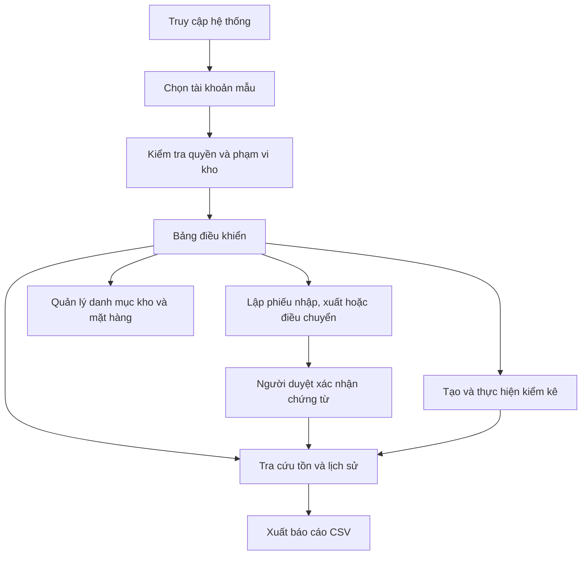
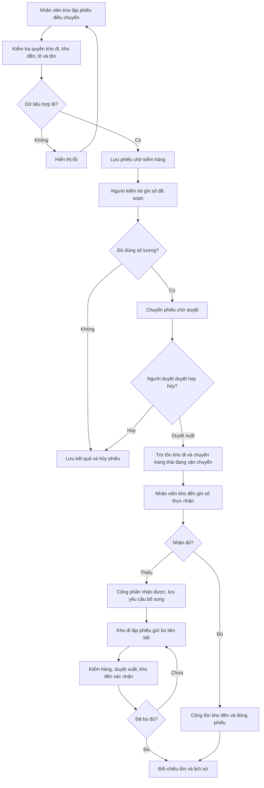
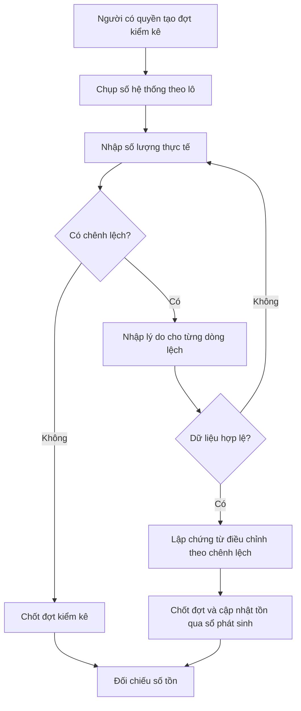

# Hệ thống quản lý kho, điều chuyển hàng và kiểm kê tại nhiều điểm

Bài tập lớn học phần **Phát triển phần mềm mã nguồn mở**, nhóm 5, lớp CNTT-1812, **đề tài 10**.

Phần mềm mã nguồn mở giúp một đơn vị có nhiều kho theo dõi số lượng hàng, ghi nhận chứng từ nhập, xuất và điều chuyển, và tìm nguyên nhân chênh lệch khi kiểm kê. Số tồn **không nhập tay**: hệ thống luôn tính lại từ sổ phát sinh của các chứng từ đã xác nhận, nên có thể đối chiếu bất cứ lúc nào.

> **Trạng thái hiện tại:** ứng dụng đọc và ghi dữ liệu qua PostgreSQL; phiếu nhập/xuất, điều chuyển, kiểm kê và điều chỉnh được ghi sổ. Lịch sử hỗ trợ lọc kỳ, đối chiếu với kiểm kê đã chốt và xuất CSV.

## Người sử dụng

| Vai trò                 | Quyền                                                                            |
| ----------------------- | -------------------------------------------------------------------------------- |
| Nhân viên kho           | Lập phiếu nhập, xuất, điều chuyển ở kho phụ trách; lập điều chỉnh cho chứng từ đã ghi nhận; tra cứu tồn và lịch sử |
| Người duyệt chứng từ    | Duyệt nhập/xuất/điều chỉnh; duyệt xuất hoặc hủy phiếu điều chuyển đã kiểm đủ; cần quyền ở mọi kho thuộc chứng từ |
| Người phụ trách kiểm kê | Kiểm số hàng đã soạn ở kho đi; thiếu thì hủy phiếu, đủ thì chuyển người duyệt     |

Mỗi tài khoản chỉ thao tác trên **các kho được phân quyền**. Nhân viên lập phiếu từ kho đi mình phụ trách và chọn một kho đến đang hoạt động. Người kiểm kê kiểm hàng ở kho đi; người duyệt cần quyền ở cả hai kho. Khi duyệt xuất, tồn kho đi giảm; tồn kho đến chỉ tăng theo số thực nhận được xác nhận.

## Chức năng

| #   | Chức năng                                                                                      | Trang                                            | Trạng thái            |
| --- | ---------------------------------------------------------------------------------------------- | ------------------------------------------------ | --------------------- |
| 1   | Quản lý kho, mặt hàng, đơn vị tính, lô hàng và quyền theo kho                                  | `/warehouses.php`, `/items.php`, `/access.php`   | Đã ghi PostgreSQL; quản trị viên quản lý danh mục |
| 2   | Lập, kiểm tra, xác nhận phiếu nhập/xuất; tra cứu tồn từ dòng phát sinh                         | `/voucher-new.php`, `/voucher.php`, `/stock.php` | Đã lưu PostgreSQL; ghi sổ khi duyệt |
| 3   | Điều chuyển giữa hai kho, có kiểm hàng, duyệt xuất và nhận hàng                                 | `/voucher-new.php?type=transfer`, `/voucher.php` | Đã ghi PostgreSQL theo giao dịch |
| 4   | Tạo đợt kiểm kê, nhập số thực tế, tính chênh lệch, lập chứng từ điều chỉnh có lý do            | `/counts.php`, `/count.php`                      | Đã ghi PostgreSQL; chốt theo tồn mới nhất |
| 5   | Lịch sử hàng theo kỳ, đối chiếu tồn, xuất CSV; sửa bằng chứng từ điều chỉnh, không xóa lịch sử | `/history.php`, `/export.php`, `/adjust-new.php` | Đã ghi PostgreSQL; lịch sử chỉ nối thêm |

## Luồng hoạt động

### Luồng sử dụng tổng quát



### Luồng chứng từ và cập nhật tồn



### Luồng kiểm kê



> **Lưu ý:** Điều chuyển được ghi theo các giai đoạn có transaction riêng: duyệt xuất trừ tồn kho đi; xác nhận nhận hàng cộng đúng số thực nhận ở kho đến. Nếu thiếu, kho đi lập phiếu gửi bù liên kết và kho đến xác nhận như một lần giao mới. Phiếu nhập/xuất thường được lưu nháp và chỉ ghi phát sinh sau khi duyệt. Khi chốt kiểm kê, hệ thống lấy tồn mới nhất, tính delta và cập nhật cùng chứng từ kiểm kê trong một giao dịch.

### Hai yêu cầu kỹ thuật

1. **Sổ phát sinh và giao dịch cập nhật tồn.** Khi nhiều yêu cầu cùng xuất, số tồn không được âm. Gửi lại một chứng từ không được ghi nhận thêm lần nữa.
2. **Điều chuyển có kiểm soát hai đầu.** Duyệt xuất và xác nhận nhận hàng đều ghi sổ trong transaction; số nhận thực tế quyết định phát sinh tăng tại kho đến.

`src/StockLedger.php` tính tồn từ sổ. Khi người duyệt duyệt xuất, ứng dụng khóa theo kho/lô, kiểm tra tồn mới nhất, ghi giảm kho đi và chuyển phiếu sang đang vận chuyển trong cùng transaction. Khi kho đến xác nhận, hệ thống ghi tăng đúng số thực nhận cùng biên bản thiếu (nếu có) trong một transaction khác. Khóa yêu cầu duy nhất ngăn gửi lại form tạo phiếu trùng.

## Cài đặt và chạy

Yêu cầu: Ubuntu hoặc WSL, **PHP 8.1 trở lên**, Git, PostgreSQL và PHP PDO PostgreSQL. Không cần Composer hay framework.

```bash
sudo apt install php-cli php-pgsql git postgresql postgresql-client  # nếu chưa có
git clone <địa chỉ repo>
cd PTPMMNM-CNTT-1812-NHOM-5
bash app.sh check                 # kiểm tra môi trường
bash app.sh run                   # chạy tại http://127.0.0.1:8110
```

Đổi cổng bằng `PORT=8200 bash app.sh run`. Dừng máy chủ bằng `Ctrl+C`.

### Khởi tạo PostgreSQL

Schema ban đầu nằm ở `database/schema.sql`. Trên Ubuntu/WSL, khởi động PostgreSQL rồi mở phiên quản trị:

```bash
sudo service postgresql start
sudo -u postgres psql
```

Trong `psql`, nhập từng lệnh ở dấu nhắc `postgres=#`. Khi chạy `\password`, nhập mật khẩu ở hai lời nhắc của nó; đợi quay lại `postgres=#` rồi mới nhập lệnh kế tiếp:

```sql
CREATE ROLE ptpmmnm_cntt_1812_nhom_5 LOGIN;
```

```text
\password ptpmmnm_cntt_1812_nhom_5
```

```sql
CREATE DATABASE ptpmmnm_cntt_1812_nhom_5 OWNER ptpmmnm_cntt_1812_nhom_5;
\q
```

Chạy lại lệnh `CREATE` chỉ khi các tên đó chưa tồn tại. Sau đó kết nối đúng database và nạp bảng:

```bash
psql -h 127.0.0.1 -U ptpmmnm_cntt_1812_nhom_5 -d ptpmmnm_cntt_1812_nhom_5
```

```sql
\i database/schema.sql
\dt
\q
```

Sau khi chạy các lệnh trên, database và schema sẽ sẵn sàng. Khi nâng cấp database đã cài từ phiên bản cũ, chạy lại `\i database/schema.sql` để tạo các bảng workflow, gửi bù và điều chỉnh, cùng các cột phục vụ đối chiếu kiểm kê. Từ thư mục dự án, cấu hình kết nối ứng dụng:

```bash
php tools/db-config.php
```

Nhập cùng host, database, user và mật khẩu vừa tạo. Công cụ thử kết nối trước khi lưu `.local/db.json` với quyền riêng tư; tệp này đã được loại khỏi Git. Sau đó `bash app.sh run` sẽ đọc các bảng PostgreSQL. Bảng đang rỗng cho đến khi nạp dữ liệu mẫu. Phiếu nhập/xuất, điều chuyển, gửi bù, kiểm kê, điều chỉnh và lịch sử phát sinh được lưu PostgreSQL.

Để nạp dữ liệu mẫu (chạy từ thư mục gốc của dự án):

```bash
psql -h 127.0.0.1 -U ptpmmnm_cntt_1812_nhom_5 -d ptpmmnm_cntt_1812_nhom_5 -f database/seed.sql
```

Lệnh sẽ hỏi mật khẩu database. `database/seed.sql` nạp 3 kho, 30 mặt hàng và 203 dòng phát sinh; script chỉ chạy khi các bảng đang trống.

### Tài khoản mẫu

Trang đăng nhập dùng tên đăng nhập và mật khẩu. Năm tài khoản mẫu dùng chung mật khẩu `KhoMau@2026`:

| Tài khoản                | Vai trò              | Kho             |
| ------------------------ | -------------------- | --------------- |
| `nv.hn`, Nguyễn Văn An   | Nhân viên kho        | KHO-HN          |
| `nv.dn`, Trần Thị Bình   | Nhân viên kho        | KHO-DN          |
| `duyet`, Lê Minh Châu    | Người duyệt chứng từ | Cả 3 kho        |
| `kiemke`, Phạm Quốc Dũng | Phụ trách kiểm kê    | KHO-HN, KHO-HCM |
| `quantri`, Quản trị hệ thống | Quản trị danh mục | Cả 3 kho |

Mật khẩu được lưu dưới dạng hash trong database. Tài khoản `quantri` quản lý kho, mặt hàng, đơn vị tính, lô hàng, tài khoản và phạm vi kho; không dùng tài khoản mẫu này ngoài môi trường demo. Nếu database mẫu đã có từ phiên bản trước, chạy lại `database/schema.sql` rồi nạp `database/migrate-catalog-admin.sql` để thêm quản trị viên demo. Nếu dữ liệu mẫu đã được nạp trước khi có mật khẩu, chạy `database/demo-passwords.sql` một lần. Đây là mật khẩu dùng cho dữ liệu giả lập.

## Hai tình huống demo

1. **Nhập → xác nhận → xuất → tra cứu.** Đăng nhập `nv.hn` để lập phiếu nhập. Đổi sang `duyet` để mở phiếu chờ duyệt và xác nhận. Sau đó lập phiếu xuất, rồi vào _Tra cứu tồn_ và _Lịch sử phát sinh_ để đối chiếu.
2. **Điều chuyển → kiểm kê → điều chỉnh.** Đăng nhập `nv.hn` để lập phiếu KHO-HN → KHO-DN; `kiemke` kiểm số đã soạn tại KHO-HN và chuyển phiếu cho `duyet`; `duyet` duyệt xuất; `nv.dn` xác nhận số thực nhận ở KHO-DN. Nếu thiếu, `nv.dn` ghi số lượng và lý do để `nv.hn` xem yêu cầu bổ sung trên phiếu. Đợt `KK-0001` là mẫu kiểm kê đã chốt.

## Kiểm thử

```bash
bash app.sh test    # logic nghiệp vụ: TESTS=19 FAILED=0
bash app.sh lint    # kiểm tra cú pháp mọi tệp PHP
```

Đối chiếu với các phép thử bắt buộc của đề:

| Phép thử bắt buộc                                                 | Hiện tại                                                                    |
| ----------------------------------------------------------------- | --------------------------------------------------------------------------- |
| Kho còn 5, hai yêu cầu cùng xuất 4: chỉ một phiếu được ghi nhận   | Điều chuyển khóa tồn theo kho/lô và kiểm tra trong transaction; cần kiểm thử đồng thời ⏳ |
| Lỗi giữa các dòng phát sinh của cùng một giai đoạn                 | Các dòng của mỗi giai đoạn được ghi trong transaction; cần kiểm thử rollback tích hợp ⏳ |
| Gửi lại phiếu hoặc xác nhận điều chuyển đã xử lý                  | Khóa form chống tạo phiếu trùng; khóa dòng phiếu/trạng thái ngăn duyệt hoặc nhận lần hai |
| Tài khoản kho A không lập phiếu xuất kho B bằng yêu cầu trực tiếp | ✔ `WAREHOUSE_FORBIDDEN`, kiểm tra ở `validateVoucher` và mọi trang chi tiết |
| Điều chỉnh kiểm kê có lý do; tồn sau điều chỉnh khớp lịch sử      | ✔ bắt buộc lý do (`REASON_REQUIRED`); điều chỉnh khớp tổng chênh lệch       |

## Cấu trúc mã nguồn

Phần xử lý được tách khỏi giao diện và lưu trữ, theo cách tổ chức của các bài lab:

```
public/        Trang Web: nhận request, gọi xử lý, hiển thị (không chứa quy tắc nghiệp vụ)
  assets/css/  Giao diện (CSS thuần, có chế độ tối)
src/
  bootstrap.php   Session, CSRF, hàm hiển thị dùng chung
  StockLedger.php Quy tắc tồn kho thuần: tính tồn từ sổ, phát sinh của chứng từ, phát hiện tồn âm
  VoucherService.php Lưu phiếu nháp và xác nhận phiếu nhập/xuất trong giao dịch
  Validation.php  Kiểm tra form phía máy chủ, trả ['errors' => [...], 'data' => [...]]
  Auth.php        Người dùng hiện tại, quyền theo kho, quyền xác nhận
  TransferService.php Kiểm hàng, duyệt xuất, nhận hàng và ghi sổ điều chuyển
  Store.php       Đọc dữ liệu PostgreSQL theo cấu trúc dùng trong giao diện
  Database.php    Mở kết nối PostgreSQL từ cấu hình cục bộ
  Input.php       Đọc đầu vào an toàn và escape HTML (e())
templates/     Phần đầu/cuối trang, hộp lỗi
tests/         Bộ kiểm thử logic
tools/         Cấu hình kết nối PostgreSQL
app.sh         check | run | test | lint
```

Quy ước: mọi thao tác thay đổi dữ liệu dùng POST, có CSRF token và chuyển hướng 303. Mọi giá trị in ra HTML đều qua `e()`. Kiểm tra quyền luôn đặt ở phía máy chủ.

## Dữ liệu mẫu

Các bảng PostgreSQL hiện chưa được nạp dữ liệu. Cần thêm dữ liệu mẫu trước khi dùng chức năng đăng nhập và tra cứu. Đề bài yêu cầu tối thiểu **3 kho, 30 mặt hàng và 200 dòng phát sinh**.

Bảng PostgreSQL gồm `warehouses`, `items`, `batches`, `users`, `user_warehouses`, `vouchers`, `voucher_lines`, `stock_movements`, `transfer_workflow`, `transfer_checks`, `transfer_receipt_lines`, `stock_counts` và `stock_count_lines`.

## Lộ trình

- [x] Giao diện 5 nhóm chức năng, quyền theo kho, dữ liệu mẫu
- [x] Quy tắc sổ phát sinh và kiểm thử logic
- [x] Schema PostgreSQL và lớp đọc dữ liệu qua PDO
- [x] Quản lý danh mục kho, mặt hàng, đơn vị tính, lô hàng và phân quyền tài khoản theo kho
- [ ] Nạp dữ liệu mẫu vào PostgreSQL
- [ ] Xác nhận chứng từ trong giao dịch: khóa dòng tồn (`SELECT … FOR UPDATE`), ràng buộc `CHECK`, khóa idempotency cho chứng từ
- [x] Ghi nhận điều chuyển trong một giao dịch; [ ] kiểm thử rollback khi gây lỗi giữa hai thao tác
- [ ] Kiểm thử tích hợp cho 5 phép thử bắt buộc, kể cả hai yêu cầu xuất đồng thời
- [x] Đăng nhập bằng mật khẩu (`password_hash`)
- [ ] GitHub Actions và bản phát hành

Không thuộc phạm vi: sản xuất, thuế, kế toán tài chính, website bán hàng, thanh toán.

## Đóng góp và giấy phép

- Quy trình issue, nhánh và review: xem [CONTRIBUTING.md](CONTRIBUTING.md).
- Mã nguồn phát hành theo giấy phép [MIT](LICENSE).
- **Nguồn tái sử dụng:** cách tổ chức `field()`, `e()`, `checkCsrf()` và mẫu `tests/helper.php` dựa trên mã mẫu CommunityPass của các bài lab học phần. Phần còn lại do nhóm tự viết. Không dùng thư viện bên ngoài.
