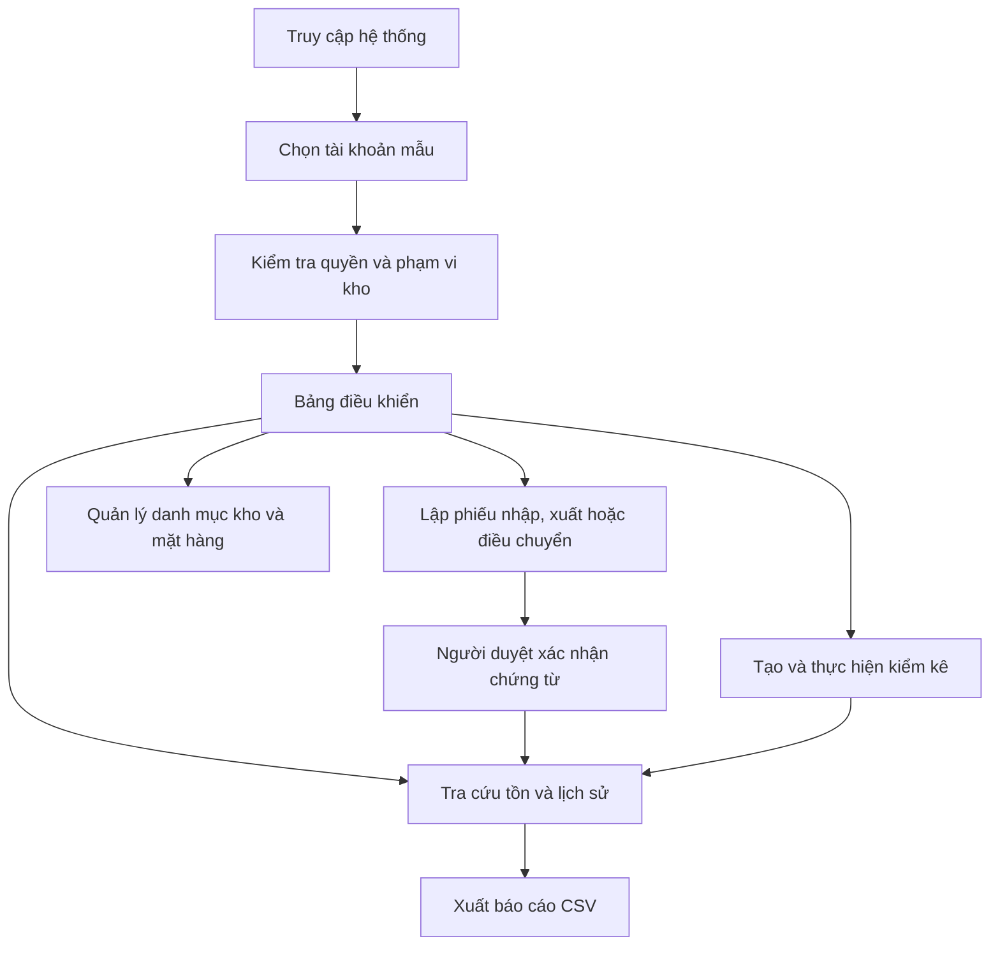
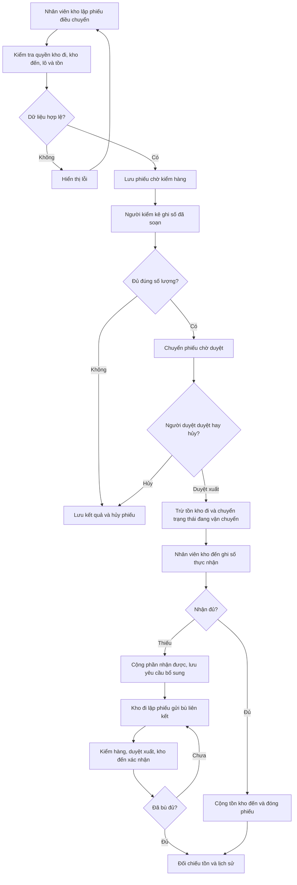
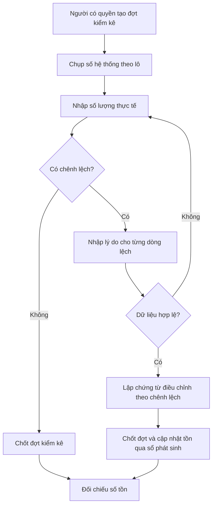

# Hệ thống quản lý kho, chuỗi cung ứng và phân phối

Bài tập lớn học phần **Phát triển phần mềm mã nguồn mở**, nhóm 5, lớp CNTT-1812, **đề tài 10**.

Phần mềm giúp một đơn vị theo dõi kho tổng, kho địa điểm, nhà cung cấp và phân phối đến đại lý/cửa hàng/siêu thị. Số tồn **không nhập tay**: hệ thống tính từ sổ phát sinh của chứng từ đã xác nhận, gồm cả tồn vận hành tại điểm bán.

> **Trạng thái hiện tại:** ứng dụng đọc và ghi dữ liệu qua PostgreSQL; phiếu nhập/xuất, điều chuyển, kiểm kê, điều chỉnh và các cấu trúc phân phối được hỗ trợ. Regression test đạt `TESTS=27 FAILED=0`; integration/concurrency test vẫn chưa chạy.

## Người sử dụng

| Vai trò                 | Quyền                                                                            |
| ----------------------- | -------------------------------------------------------------------------------- |
| Nhân viên kho           | Lập phiếu nhập, xuất, điều chuyển ở kho phụ trách; lập điều chỉnh cho chứng từ đã ghi nhận; tra cứu tồn và lịch sử |
| Người duyệt chứng từ    | Duyệt nhập/xuất/điều chỉnh; duyệt xuất hoặc hủy phiếu điều chuyển đã kiểm đủ; cần quyền ở mọi kho thuộc chứng từ |
| Người phụ trách kiểm kê | Kiểm số hàng đã soạn ở kho đi; thiếu thì hủy phiếu, đủ thì chuyển người duyệt     |
| Quản lý kho tổng | Quản lý kho tổng và các nghiệp vụ nhập/phân bổ trong phạm vi được cấp |
| Quản lý kho địa điểm | Quản lý kho địa điểm và đơn phân phối trong phạm vi được cấp |
| Người dùng điểm bán | Chỉ xem điểm bán được liên kết, tạo đơn và xác nhận nhận hàng |
| Quản trị viên | Quản lý danh mục, tài khoản, phân quyền và báo cáo; không mặc định thay người duyệt |

Tài khoản nội bộ chỉ thao tác trên **các kho được phân quyền**; tài khoản điểm bán chỉ thao tác trên **điểm bán được liên kết**. Nhân viên lập phiếu từ kho đi mình phụ trách và chọn tuyến được phép. Người kiểm kê kiểm hàng ở kho đi; người duyệt cần quyền ở các kho thuộc chứng từ. Khi duyệt xuất, tồn kho đi giảm; tồn kho đến/điểm bán chỉ tăng theo số thực nhận được xác nhận.

## Chức năng

| #   | Chức năng                                                                                      | Trang                                            | Trạng thái            |
| --- | ---------------------------------------------------------------------------------------------- | ------------------------------------------------ | --------------------- |
| 1   | Quản lý kho, mặt hàng, đơn vị tính, lô hàng và quyền theo kho                                  | `/warehouses.php`, `/items.php`, `/access.php`   | Đã ghi PostgreSQL; quản trị viên quản lý danh mục |
| 2   | Lập, kiểm tra, xác nhận phiếu nhập/xuất; tra cứu tồn từ dòng phát sinh                         | `/voucher-new.php`, `/voucher.php`, `/stock.php` | Đã lưu PostgreSQL; ghi sổ khi duyệt |
| 3   | Điều chuyển giữa hai kho, có kiểm hàng, duyệt xuất và nhận hàng                                 | `/voucher-new.php?type=transfer`, `/voucher.php` | Đã ghi PostgreSQL theo giao dịch |
| 4   | Tạo đợt kiểm kê, nhập số thực tế, tính chênh lệch, lập chứng từ điều chỉnh có lý do            | `/counts.php`, `/count.php`                      | Đã ghi PostgreSQL; chốt theo tồn mới nhất |
| 5   | Lịch sử hàng theo kỳ, đối chiếu tồn, xuất CSV; sửa bằng chứng từ điều chỉnh, không xóa lịch sử | `/history.php`, `/export.php`, `/adjust-new.php` | Đã ghi PostgreSQL; lịch sử chỉ nối thêm |
| 6   | Nhà cung cấp và nguồn của phiếu nhập | `/suppliers.php`, `/voucher-new.php?type=in` | Đã có service và migration |
| 7   | Điểm bán, đơn phân phối, giao nhận và tồn điểm bán | `/sales-points.php`, `/sales-orders.php`, `/sales-order.php`, `/sales-stock.php` | Đã có cấu trúc và luồng cơ bản; cần integration test |

## Luồng hoạt động

### Luồng sử dụng tổng quát



### Luồng chứng từ và cập nhật tồn



### Luồng kiểm kê



> **Lưu ý:** Điều chuyển được ghi theo các giai đoạn có transaction riêng: duyệt xuất trừ tồn kho đi; xác nhận nhận hàng cộng đúng số thực nhận ở kho đến. Nếu thiếu, kho đi lập phiếu gửi bù liên kết và kho đến xác nhận như một lần giao mới. Phiếu nhập/xuất thường được lưu nháp và chỉ ghi phát sinh sau khi duyệt. Khi chốt kiểm kê, hệ thống lấy tồn mới nhất, tính delta và cập nhật cùng chứng từ kiểm kê trong một giao dịch.

### Hai yêu cầu kỹ thuật

1. **Sổ phát sinh và giao dịch cập nhật tồn.** Khi nhiều yêu cầu cùng xuất, số tồn không được âm. Gửi lại một chứng từ không được ghi nhận thêm lần nữa.
2. **Điều chuyển có kiểm soát hai đầu.** Duyệt xuất và xác nhận nhận hàng đều ghi sổ trong transaction; số nhận thực tế quyết định phát sinh tăng tại kho đến.

`src/StockLedger.php` tính tồn từ sổ. Khi người duyệt duyệt xuất, ứng dụng khóa theo kho/lô, kiểm tra tồn mới nhất, ghi giảm kho đi và chuyển phiếu sang đang vận chuyển trong cùng transaction. Khi kho đến xác nhận, hệ thống ghi tăng đúng số thực nhận cùng biên bản thiếu (nếu có) trong một transaction khác. Khóa yêu cầu duy nhất ngăn gửi lại form tạo phiếu trùng.

## Cài đặt và chạy

Yêu cầu: Ubuntu hoặc WSL, **PHP 8.1 trở lên**, Git, PostgreSQL và PHP PDO PostgreSQL. Không cần Composer hay framework.

```bash
sudo apt install php-cli php-pgsql git postgresql postgresql-client  # nếu chưa có
git clone <địa chỉ repo>
cd PTPMMNM-CNTT-1812-NHOM-5
bash app.sh check                 # kiểm tra môi trường
bash app.sh run                   # chạy tại http://127.0.0.1:8110
```

Đổi cổng bằng `PORT=8200 bash app.sh run`. Dừng máy chủ bằng `Ctrl+C`.

### Deploy thử bằng Vercel và Supabase

Nhánh thử nghiệm này dùng Docker/FrankenPHP trên Vercel và PostgreSQL của Supabase. Vercel chạy ứng dụng trong container; `Dockerfile` cài `pdo_pgsql` và Caddy phục vụ thư mục `public/`. PHP session được lưu ở bảng `app_sessions` khi bật driver database, để phiên đăng nhập dùng được giữa các instance.

1. Tạo project PostgreSQL trên Supabase. Trong SQL Editor, chạy toàn bộ `database/schema.sql`, sau đó chạy `database/seed.sql` (bỏ dòng đầu `\set ON_ERROR_STOP on`, đây là lệnh dành cho `psql`). Dữ liệu seed là tài khoản demo, chỉ dùng để thử.
2. Chạy `database/vercel-sessions.sql` trong SQL Editor để tạo bảng lưu session.
3. Trong Supabase, mở **Connect** và lấy connection string **Transaction pooler**. Không đưa chuỗi này vào Git.
4. Import repo vào Vercel và chọn branch `deploy/vercel-supabase-trial`. Vercel nhận `Dockerfile` ở thư mục gốc; đặt biến môi trường cho Preview:

   | Tên | Giá trị |
   | --- | --- |
   | `DATABASE_URL` | URI transaction pooler từ Supabase, gồm user, mật khẩu đã URL-encode, host, port và database |
   | `SESSION_DRIVER` | `database` |
   | `PG_EMULATE_PREPARES` | `true` (transaction pooler không hỗ trợ prepared statements phía server) |

   URI có thể có dạng `postgresql://postgres.<project-ref>:<password>@<pooler-host>:6543/postgres`; hãy dùng đúng URI Supabase cung cấp, không tự đoán pooler host.
5. Deploy Preview và thử đăng nhập, mở trang kho, tạo phiếu demo, đăng xuất rồi đăng nhập lại. Khi cần cập nhật code, push commit lên branch này để Vercel tạo Preview mới.

Có thể chạy app cục bộ như trước bằng `.local/db.json`; session mặc định vẫn là session file. Không đặt `DATABASE_URL` hoặc `SESSION_DRIVER=database` trên môi trường local nếu chưa tạo bảng session Supabase.

### Khởi tạo PostgreSQL

Schema ban đầu nằm ở `database/schema.sql`. Trên Ubuntu/WSL, khởi động PostgreSQL rồi mở phiên quản trị:

```bash
sudo service postgresql start
sudo -u postgres psql
```

Trong `psql`, nhập từng lệnh ở dấu nhắc `postgres=#`. Khi chạy `\password`, nhập mật khẩu ở hai lời nhắc của nó; đợi quay lại `postgres=#` rồi mới nhập lệnh kế tiếp:

```sql
CREATE ROLE ptpmmnm_cntt_1812_nhom_5 LOGIN;
```

```text
\password ptpmmnm_cntt_1812_nhom_5
```

```sql
CREATE DATABASE ptpmmnm_cntt_1812_nhom_5 OWNER ptpmmnm_cntt_1812_nhom_5;
\q
```

Chạy lại lệnh `CREATE` chỉ khi các tên đó chưa tồn tại. Sau đó kết nối đúng database và nạp bảng:

```bash
psql -h 127.0.0.1 -U ptpmmnm_cntt_1812_nhom_5 -d ptpmmnm_cntt_1812_nhom_5
```

```sql
\i database/schema.sql
\dt
\q
```

Sau khi chạy các lệnh trên, database và schema sẽ sẵn sàng. Khi nâng cấp database đã cài từ phiên bản cũ, chạy lại `\i database/schema.sql` để tạo các bảng workflow, gửi bù và điều chỉnh, cùng các cột phục vụ đối chiếu kiểm kê. Sau đó chạy migration chuỗi cung ứng trong một phiên `psql`:

```bash
psql -h 127.0.0.1 -U ptpmmnm_cntt_1812_nhom_5 -d ptpmmnm_cntt_1812_nhom_5 -f database/migrations/001_supply_chain.sql
```

Migration tạo kho tổng `CENTRAL-01`, chuyển ba kho cũ thành `REGIONAL` trực thuộc kho tổng, tạo nhà cung cấp, điểm bán, đơn/giao phân phối và mở rộng sổ phát sinh. Migration không di chuyển tồn, không nạp dữ liệu mẫu và có thể chạy lặp lại. Hãy backup và kiểm tra preflight trước khi chạy trên database có dữ liệu thật.

Từ thư mục dự án, cấu hình kết nối ứng dụng:

```bash
php tools/db-config.php
```

Nhập cùng host, database, user và mật khẩu vừa tạo. Công cụ thử kết nối trước khi lưu `.local/db.json` với quyền riêng tư; tệp này đã được loại khỏi Git. Sau đó `bash app.sh run` sẽ đọc các bảng PostgreSQL. Database mới sẽ rỗng cho đến khi nạp dữ liệu mẫu; database nâng cấp có thể đã có dữ liệu nghiệp vụ. Phiếu nhập/xuất, điều chuyển, gửi bù, kiểm kê, điều chỉnh và lịch sử phát sinh được lưu PostgreSQL.

Để nạp dữ liệu mẫu (chạy từ thư mục gốc của dự án):

```bash
psql -h 127.0.0.1 -U ptpmmnm_cntt_1812_nhom_5 -d ptpmmnm_cntt_1812_nhom_5 -f database/seed.sql
```

Lệnh sẽ hỏi mật khẩu database. `database/seed.sql` nạp 3 kho, 30 mặt hàng và 203 dòng phát sinh; script chỉ chạy khi các bảng đang trống.

Trên môi trường development/test/demo, sau migration chuỗi cung ứng có thể nạp tài khoản và điểm bán demo bằng lệnh có cờ xác nhận:

```bash
psql -h 127.0.0.1 -U ptpmmnm_cntt_1812_nhom_5 -d ptpmmnm_cntt_1812_nhom_5 \
  -v demo_seed=1 -f database/seed-supply-chain-demo.sql
```

Seed giữ nguyên 5 tài khoản cũ, tạo thêm 8 tài khoản và 3 điểm bán, có thể chạy lại mà không tạo trùng. Mật khẩu demo dùng chung `KhoMau@2026`, được lưu bằng bcrypt hash và không được dùng trên production.

### Tài khoản mẫu

Trang đăng nhập dùng tên đăng nhập và mật khẩu. Năm tài khoản mẫu dùng chung mật khẩu `KhoMau@2026`:

| Tài khoản                | Vai trò              | Kho             |
| ------------------------ | -------------------- | --------------- |
| `nv.hn`, Nguyễn Văn An   | Nhân viên kho        | KHO-HN          |
| `nv.dn`, Trần Thị Bình   | Nhân viên kho        | KHO-DN          |
| `duyet`, Lê Minh Châu    | Người duyệt chứng từ | Cả 3 kho        |
| `kiemke`, Phạm Quốc Dũng | Phụ trách kiểm kê    | KHO-HN, KHO-HCM |
| `quantri`, Quản trị hệ thống | Quản trị danh mục | Cả 3 kho |

Mật khẩu được lưu dưới dạng hash trong database. Tài khoản `quantri` quản lý kho, mặt hàng, đơn vị tính, lô hàng, tài khoản và phạm vi kho; không dùng tài khoản mẫu này ngoài môi trường demo. Nếu database mẫu đã có từ phiên bản trước, chạy lại `database/schema.sql` rồi nạp `database/migrate-catalog-admin.sql` để thêm quản trị viên demo. Nếu dữ liệu mẫu đã được nạp trước khi có mật khẩu, chạy `database/demo-passwords.sql` một lần. Đây là mật khẩu dùng cho dữ liệu giả lập.

Sau khi chạy `database/seed-supply-chain-demo.sql`, có thêm 8 tài khoản: `ql.tong` (quản lý kho tổng), `ql.hn`, `ql.dn`, `ql.hcm` (quản lý kho địa điểm), `nv.hcm` (nhân viên Kho TP.HCM), `daily.hn`, `cuahang.dn`, `sieuthi.hcm` (người dùng điểm bán). Ba tài khoản điểm bán chỉ được liên kết với đúng một điểm bán tương ứng.

## Hai tình huống demo

1. **Nhập → xác nhận → xuất → tra cứu.** Đăng nhập `nv.hn` để lập phiếu nhập. Đổi sang `duyet` để mở phiếu chờ duyệt và xác nhận. Sau đó lập phiếu xuất, rồi vào _Tra cứu tồn_ và _Lịch sử phát sinh_ để đối chiếu.
2. **Điều chuyển → kiểm kê → điều chỉnh.** Đăng nhập `nv.hn` để lập phiếu KHO-HN → KHO-DN; `kiemke` kiểm số đã soạn tại KHO-HN và chuyển phiếu cho `duyet`; `duyet` duyệt xuất; `nv.dn` xác nhận số thực nhận ở KHO-DN. Nếu thiếu, `nv.dn` ghi số lượng và lý do để `nv.hn` xem yêu cầu bổ sung trên phiếu. Đợt `KK-0001` là mẫu kiểm kê đã chốt.
3. **Phân phối đến điểm bán.** Sau khi nạp seed demo, dùng tài khoản nội bộ tạo/duyệt đơn tại `/sales-orders.php`; tài khoản `daily.hn`, `cuahang.dn` hoặc `sieuthi.hcm` chỉ xem và xác nhận đúng điểm bán được liên kết tại `/sales-order.php`.

## Kiểm thử

```bash
bash app.sh test    # logic nghiệp vụ: TESTS=27 FAILED=0
bash app.sh lint    # kiểm tra cú pháp mọi tệp PHP
```

Đối chiếu với các phép thử bắt buộc của đề:

| Phép thử bắt buộc                                                 | Hiện tại                                                                    |
| ----------------------------------------------------------------- | --------------------------------------------------------------------------- |
| Kho còn 5, hai yêu cầu cùng xuất 4: chỉ một phiếu được ghi nhận   | Điều chuyển khóa tồn theo kho/lô và kiểm tra trong transaction; cần kiểm thử đồng thời ⏳ |
| Lỗi giữa các dòng phát sinh của cùng một giai đoạn                 | Các dòng của mỗi giai đoạn được ghi trong transaction; cần kiểm thử rollback tích hợp ⏳ |
| Gửi lại phiếu hoặc xác nhận điều chuyển đã xử lý                  | `request_key`, unique constraint và khóa trạng thái ngăn tạo/ghi sổ trùng; cần integration test retry đầy đủ |
| Tài khoản kho A không lập phiếu xuất kho B bằng yêu cầu trực tiếp | ✔ `WAREHOUSE_FORBIDDEN`, kiểm tra ở `validateVoucher` và mọi trang chi tiết |
| Điều chỉnh kiểm kê có lý do; tồn sau điều chỉnh khớp lịch sử      | ✔ bắt buộc lý do (`REASON_REQUIRED`); điều chỉnh khớp tổng chênh lệch       |

## Cấu trúc mã nguồn

Phần xử lý được tách khỏi giao diện và lưu trữ, theo cách tổ chức của các bài lab:

```
public/        Trang Web: nhận request, kiểm tra đầu vào/scope và gọi service; không thay thế kiểm tra trong service
  assets/css/  Giao diện (CSS thuần, có chế độ tối)
src/
  bootstrap.php   Session, CSRF, hàm hiển thị dùng chung
  StockLedger.php Quy tắc tồn kho thuần: tính tồn từ sổ, phát sinh của chứng từ, phát hiện tồn âm
  VoucherService.php Lưu phiếu nháp và xác nhận phiếu nhập/xuất trong giao dịch
  Validation.php  Kiểm tra form phía máy chủ, trả ['errors' => [...], 'data' => [...]]
  Auth.php        Người dùng hiện tại, quyền theo kho, quyền xác nhận
  TransferService.php Kiểm hàng, duyệt xuất, nhận hàng và ghi sổ điều chuyển
  Store.php       Đọc dữ liệu PostgreSQL theo cấu trúc dùng trong giao diện
  Database.php    Mở kết nối PostgreSQL từ cấu hình cục bộ
  Input.php       Đọc đầu vào an toàn và escape HTML (e())
  SupplierService.php Quản lý nhà cung cấp
  SalesPointService.php Quản lý điểm bán
  SalesOrderService.php Đơn phân phối, giao hàng và nhận hàng
templates/     Phần đầu/cuối trang, hộp lỗi
tests/         Bộ kiểm thử logic
tools/         Cấu hình kết nối PostgreSQL
app.sh         check | run | test | lint
```

Quy ước: mọi thao tác thay đổi dữ liệu dùng POST, có CSRF token và chuyển hướng 303. Mọi giá trị in ra HTML đều qua `e()`. Kiểm tra quyền luôn đặt ở phía máy chủ.

Database dùng `numeric(14,3)` cho số lượng, nhưng một số đường code cũ và giao diện hiện vẫn nhận số nguyên. Chưa dùng nghiệp vụ số thập phân trong production cho đến khi hoàn tất refactor fixed-point và test độ chính xác.

## Dữ liệu mẫu

Các bảng PostgreSQL hiện chưa được nạp dữ liệu. Cần thêm dữ liệu mẫu trước khi dùng chức năng đăng nhập và tra cứu. Đề bài yêu cầu tối thiểu **3 kho, 30 mặt hàng và 200 dòng phát sinh**.

Bảng PostgreSQL nền gồm `warehouses`, `items`, `batches`, `users`, `user_warehouses`, `vouchers`, `voucher_lines`, `stock_movements`, `transfer_workflow`, `transfer_checks`, `transfer_receipt_lines`, `stock_counts` và `stock_count_lines`. Migration chuỗi cung ứng bổ sung `suppliers`, `sales_points`, `sales_point_warehouses`, `user_sales_points`, `sales_orders`, `sales_order_lines`, `sales_deliveries` và `sales_delivery_lines`.

## Lộ trình

- [x] Giao diện 5 nhóm chức năng, quyền theo kho, dữ liệu mẫu
- [x] Quy tắc sổ phát sinh và kiểm thử logic
- [x] Schema PostgreSQL và lớp đọc dữ liệu qua PDO
- [x] Quản lý danh mục kho, mặt hàng, đơn vị tính, lô hàng và phân quyền tài khoản theo kho
- [ ] Nạp dữ liệu mẫu vào PostgreSQL
- [ ] Xác nhận chứng từ trong giao dịch: khóa dòng tồn (`SELECT … FOR UPDATE`), ràng buộc `CHECK`, khóa idempotency cho chứng từ
- [x] Ghi nhận điều chuyển trong một giao dịch; [ ] kiểm thử rollback khi gây lỗi giữa hai thao tác
- [ ] Kiểm thử tích hợp cho 5 phép thử bắt buộc, kể cả hai yêu cầu xuất đồng thời
- [x] Đăng nhập bằng mật khẩu (`password_hash`)
- [x] Mở rộng chuỗi cung ứng: nhà cung cấp, điểm bán, đơn/giao phân phối và tồn điểm bán
- [x] Migration tương thích ngược và entrypoint versioned (`database/migrations/001_supply_chain.sql`)
- [x] Seed demo idempotent cho 13 tài khoản và 3 điểm bán (`database/seed-supply-chain-demo.sql`)
- [ ] GitHub Actions và bản phát hành

Không thuộc phạm vi: sản xuất, thuế, kế toán tài chính, website bán hàng, thanh toán.

## Đóng góp và giấy phép

- Quy trình issue, nhánh và review: xem [CONTRIBUTING.md](CONTRIBUTING.md).
- Mã nguồn phát hành theo giấy phép [MIT](LICENSE).
- **Nguồn tái sử dụng:** cách tổ chức `field()`, `e()`, `checkCsrf()` và mẫu `tests/helper.php` dựa trên mã mẫu CommunityPass của các bài lab học phần. Phần còn lại do nhóm tự viết. Không dùng thư viện bên ngoài.
