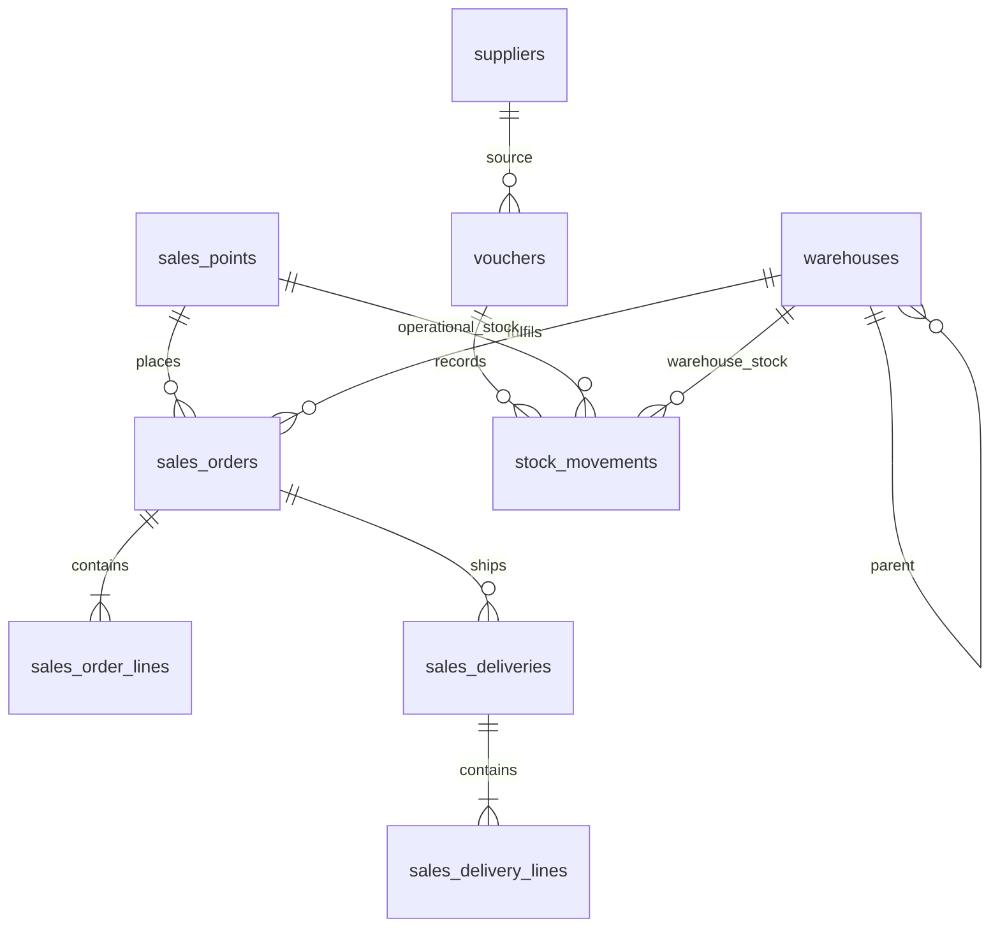

# Thiết kế Phase 2

## Phạm vi

Hệ thống giữ một sổ `stock_movements`. Kho và điểm bán là hai loại địa điểm được biểu diễn bằng các khóa ngoại riêng, không dùng khóa đa hình. `warehouses` có `CENTRAL/REGIONAL` và `parent_id`; `sales_points` có kho chính và các kho thay thế.

## Sơ đồ quan hệ

## Trạng thái phân phối

`PENDING -> APPROVED -> DELIVERING -> PARTIALLY_RECEIVED/COMPLETED`. `CANCELLED` chỉ được phép trước lần xuất đầu tiên. Xuất kho trừ tồn kho doanh nghiệp; nhận hàng ghi tồn vận hành tại điểm bán với `ownership=SOLD`, vì quyền sở hữu đã chuyển sang đối tác.

## Quyền và scope

Mọi service nhận actor và tự kiểm tra role/scope. `user_warehouses` giới hạn kho; `user_sales_points` giới hạn điểm bán. Admin không được tự động suy ra quyền nghiệp vụ kho khi chưa được gán. Các request retry phải dùng khóa idempotency và không được trả kết quả trước khi kiểm tra scope.

## Migration

`database/migrate-supply-chain.sql` là migration tương thích ngược. Nó tạo `CENTRAL-01`, chuyển ba kho cũ thành `REGIONAL` trực thuộc kho tổng, không di chuyển movement. Chạy preflight, backup và restore rehearsal trước khi chạy trên môi trường có dữ liệu thật. Migration không nạp seed.

## Khoảng chính xác số lượng

Database dùng `numeric(14,3)`. UI/service hiện tại vẫn còn một số đường cũ ép số nguyên; việc chuyển toàn bộ sang fixed-point cần hoàn tất trước khi nhận mặt hàng kg/lít. Không được dùng float để ghi sổ.
